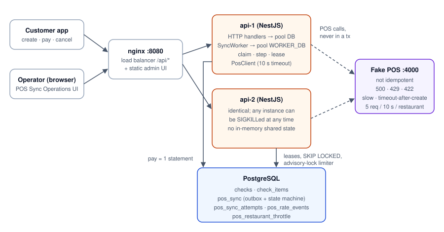
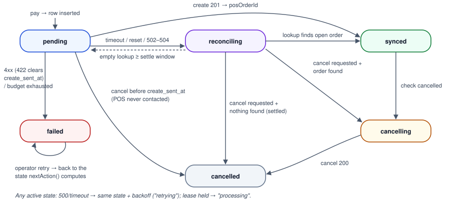
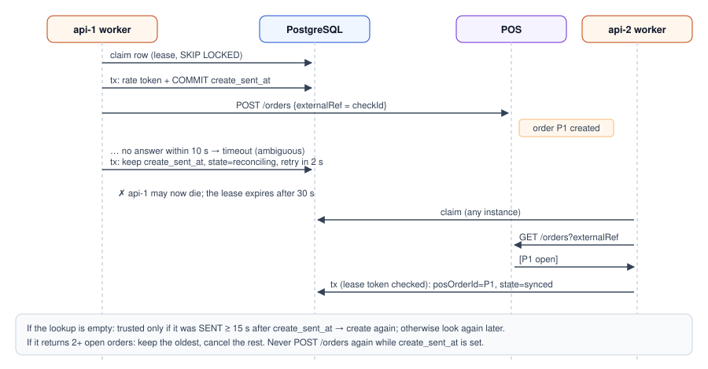
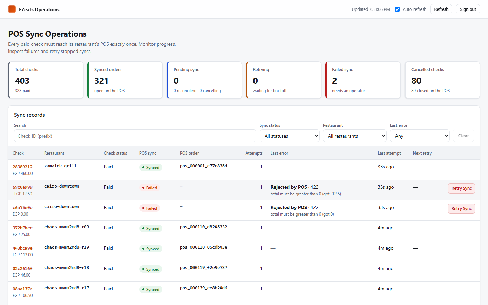
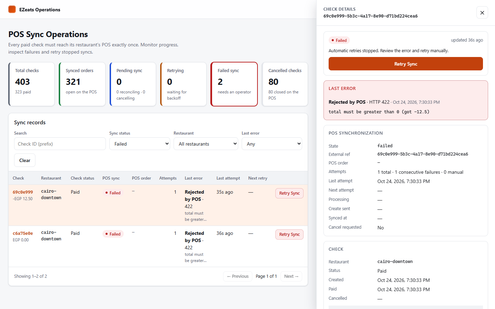
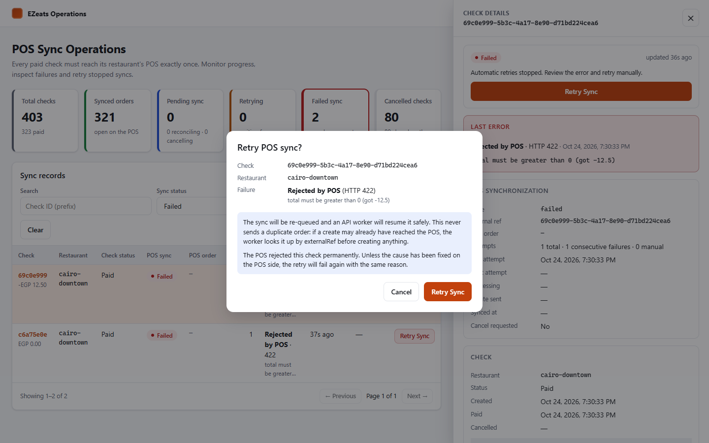
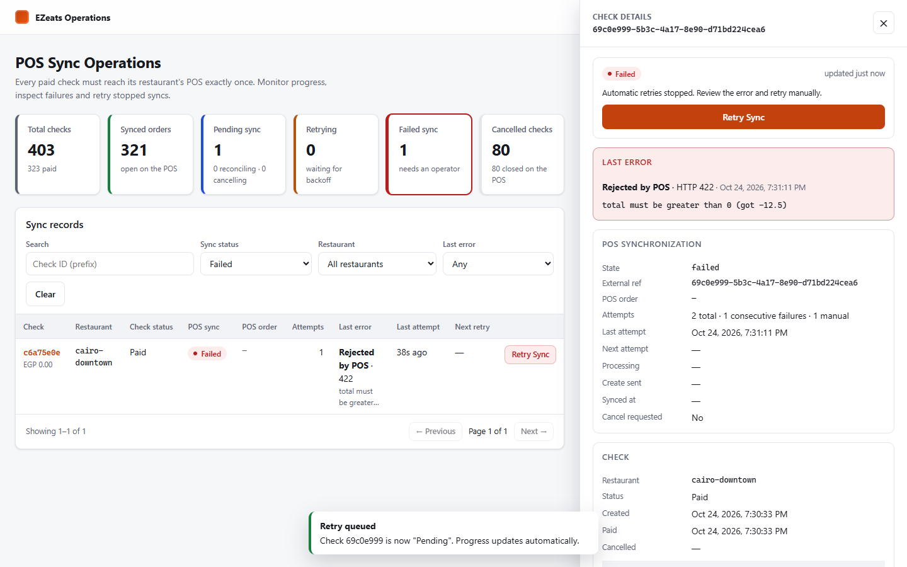

# 1. Project overview and requirements

EZeats is a food-ordering platform. Customers pay for a *check* on their phone. Every paid check
must appear on the restaurant's point-of-sale (POS) system so the kitchen can prepare it, and a
cancelled check must not leave an open order there.

The constraints are what make this hard:

- The API runs as **several identical instances** behind a load balancer. Any instance can be
  killed at any moment.
- The POS belongs to a third party. It is slow, fails sometimes, rate-limits at **5 requests per
  10 seconds per restaurant**, and is **not idempotent**: creating twice with the same
  `externalRef` creates two orders.

| # | Guarantee | How it is met (section) |
|---|---|---|
| 1 | `POST /checks/:id/pay` answers in < 300 ms even if the POS is down or slow | Pay is one SQL statement and never calls the POS (§5, §14) |
| 2 | Exactly one POS order per paid check, despite crashes, timeouts, 500/429, many instances | Transactional outbox + leases + `create_sent_at` + externalRef reconciliation (§7, §9) |
| 3 | A cancel never reaches the POS before its create; cancelled-before-create leaves nothing | Cancel only for an id the POS returned; suppression before `create_sent_at` (§5, §7) |
| 4 | ≤ 5 requests / 10 s per restaurant across all instances; a busy restaurant does not delay others | Postgres sliding window + advisory lock; fair claiming (§10) |
| 5 | Temporary errors retried; 422 stops, is visible, can be retried by hand | Classified errors, backoff, `failed` state, operator retry (§8, §11) |

Required endpoints: `POST /checks`, `POST /checks/:id/pay`, `POST /checks/:id/cancel`,
`GET /checks/:id/sync`, `POST /checks/:id/sync/retry`. The fake POS exposes `POST /orders`,
`GET /orders?externalRef=`, `POST /orders/:id/cancel` and `GET /debug/orders`.

# 2. Final architecture



| Component | Technology | Responsibility |
|---|---|---|
| `apps/api` | NestJS 10, Drizzle ORM, `pg` | HTTP API and the background sync worker. The worker runs inside every instance |
| PostgreSQL 17 | Drizzle schema + generated migrations | The single source of truth: checks, the outbox/state machine, attempt history, rate-limit log |
| `apps/fake-pos` | NestJS | Third-party POS stand-in with every failure mode from the brief |
| `apps/admin` | React 18 + Vite | "POS Sync Operations" screen for operators |
| nginx | `nginx:1.28` | Load-balances `/api/*` across `api-1` and `api-2`, and serves the UI |

Instances never talk to each other. Every piece of coordination goes through Postgres row locks,
leases and advisory locks.

# 3. Approaches compared

| | A. Synchronous POS call in the request | **B. Postgres outbox + leased workers** | C. Outbox + BullMQ/Redis |
|---|---|---|---|
| Pay latency | Bound by the POS (3–15 s); fails when the POS is down | One statement | One statement + enqueue |
| Instance killed after POS created | No record → retry duplicates | `create_sent_at` committed before sending; next owner looks the order up | Job may be retried without knowing what the POS did; still needs B's state |
| Create/cancel ordering | Two requests can race on two instances | One row per check, one lease at a time | Separate jobs can reorder; needs grouping |
| Shared rate limit | Not shared | Exact, in Postgres | Natural in Redis |
| Operational cost | Lowest | Postgres only | Two stores and a relay |
| Breaks when | Always, under any failure | Very high volume (polling, single DB) | Redis/job state disagrees with the DB |

# 4. Why B, and what it costs

All five guarantees hinge on knowing what was committed *before* a POS request left. Option B
keeps that knowledge in the same row and transaction as the check, so it cannot disagree with
itself.

A queue (C) would add faster wake-ups and a convenient limiter. It would not help with the
genuinely hard part, an ambiguous POS outcome, and it would add a second source of truth.

**Trade-offs accepted:**

- **Polling latency:** up to 250 ms before a paid check is picked up.
- **Load on Postgres:** every step is two short transactions.
- **Postgres as the bottleneck at very high volume** (§16).

# 5. Request lifecycles

**Create** `POST /checks` validates the payload with `class-validator` (whitelisted, no extra
fields), then inserts the check and its items in one transaction. It answers `201` with
`status: "open"`.

**Pay** `POST /checks/:id/pay` runs one statement:

```sql
WITH paid AS (
  UPDATE checks SET status='paid', paid_at=now() WHERE id=$1 AND status='open'
  RETURNING id, restaurant_id),
enqueued AS (
  INSERT INTO pos_sync (check_id, restaurant_id, external_ref)
  SELECT id, restaurant_id, id::text FROM paid ON CONFLICT DO NOTHING)
SELECT id FROM paid;
```

- An already-paid check returns `200` unchanged; paying is idempotent.
- A cancelled check returns `409`.
- A concurrent cancel holds the row lock, so the UPDATE re-checks `status='open'` after the cancel
  commits.

**Cancel** `POST /checks/:id/cancel` locks the check, marks it cancelled and, if it was paid, sets
`cancel_requested` on the sync row in the same transaction. What happens next depends on the row:

- **No worker holds the row:** the state is recomputed. If no create was ever committed as sent,
  the row closes as `cancelled` immediately and the POS is never contacted.
- **A worker holds the row:** only the flag is set. The worker re-reads it under lock when it
  finishes its step.

**Sync status** `GET /checks/:id/sync` returns an explicit DTO (`SyncStatusDto`):

- `state`, and `displayStatus` (processing, retrying, pending, reconciling, cancellation_pending,
  synced, cancelled, failed, awaiting_payment, not_required)
- `externalRef`, `posOrderId`, `posOrderStatus`
- `attempts`, `consecutiveFailures`, `manualRetries`
- `lastError` with its kind, HTTP status, message and time
- `lastAttemptAt`, `nextAttemptAt`, `processing` (lease owner)
- `createSentAt`, `syncedAt`, `completedAt`
- `retryable` and `retryBlockedReason`

**Manual retry** `POST /checks/:id/sync/retry` requires the operator token.

- **Sync is `failed`:** the row is locked, and its state is recomputed with `nextAction()`. That
  is `reconciling` if a create may exist, otherwise `pending`. The failure count resets, and the
  endpoint answers `202`.
- **Any other state:** it answers `409` with a code and the reason.

It never calls the POS itself, and five concurrent retries produce one `202` and four `409`s.

# 6. Database schema

| Table | Key columns | Notes |
|---|---|---|
| `checks` | `id` uuid PK, `restaurant_id`, `total` numeric(12,2), `status` enum, `paid_at`, `cancelled_at` | CHECK constraint: a cancelled check has `cancelled_at`, a paid one has `paid_at` |
| `check_items` | `check_id` FK, `position`, `name`, `quantity` > 0, `unit_price` | unique (`check_id`, `position`) |
| `pos_sync` | `check_id` PK/FK, `external_ref` **unique**, `state` enum, `cancel_requested`, `pos_order_id`, `pos_order_status`, `extra_order_ids[]`, `create_sent_at`, counters, `last_error_*`, `next_attempt_at`, `lease_owner/token/until` | The outbox row and the state machine. Partial index on `next_attempt_at` for active states |
| `pos_sync_attempts` | `check_id`, `operation`, `ok`, `error_kind`, `http_status`, `message`, `instance_id`, timings | Append-only history shown in the UI |
| `pos_rate_events` | `restaurant_id`, `sent_at` | Sliding-window log, pruned after 5 minutes |
| `pos_restaurant_throttle` | `restaurant_id` PK, `blocked_until`, `reason` | Set on an empty budget or a POS 429 |

`cancel_requested` duplicates `checks.status = 'cancelled'` on purpose. Both are written in the
same transaction, and the worker then only needs the row it already holds locked. Migrations are
generated by `drizzle-kit`. A drift check (`npm run db:check`) fails when `schema.ts` changes
without a migration.

# 7. Worker lifecycle and state transitions



Every instance polls every 250 ms. If a cycle found work, it polls again 10 ms later. One cycle:

1. **Claim.** One `UPDATE … FROM (SELECT … FOR UPDATE SKIP LOCKED)` statement leases up to
   `WORKER_CONCURRENCY` due rows. It takes at most one row per restaurant, skips throttled
   restaurants, and gives each row a new `lease_token` and `lease_until = now() + 30 s`.
2. **Begin step** (short transaction):
   1. Re-read the row `FOR UPDATE` and verify the lease token.
   2. Compute `nextAction()`.
   3. Take a rate-limit token. If there is none, reschedule and release the row.
   4. For a create, commit `create_sent_at = clock_timestamp()`.
3. **One POS request**, with no transaction open (10 s timeout, redirects not followed).
4. **Finish step** (short transaction):
   1. Record the attempt.
   2. Re-read the *fresh* row `FOR UPDATE` and verify the lease token again. If another instance
      took over, the result is discarded; that instance's next step reconciles.
   3. Apply `applyOutcome()` and `decideStep()`, persist, and release the lease.

All decisions are pure functions in `sync-machine.ts`, covered by 38 unit tests.

`nextAction()` (cancel before create is impossible by construction):

```text
extra duplicate ids?              -> cancel(duplicate)
cancel requested:
   order known & open             -> cancel(order)
   order known & cancelled        -> done: cancelled
   create never sent              -> done: cancelled   (POS never contacted)
   create maybe sent              -> lookup
otherwise:
   order known & open             -> done: synced
   create never sent              -> create
   create maybe sent              -> lookup
```

**Shutdown.** On SIGTERM the worker stops claiming, waits for the claim cycle in progress, then
waits for in-flight steps before the connection pools close. A SIGKILL simply leaves leases to
expire, after which another instance continues the work.

# 8. Retry policy

| POS outcome | Classification | Create: `create_sent_at` | Next step | Counts toward budget |
|---|---|---|---|---|
| 201 / 200 | success | kept | done or next action | resets to 0 |
| 500 | server_error, not applied | cleared | same action after backoff | yes |
| 429 | rate_limited, not applied | cleared | after `Retry-After`; whole restaurant blocked | **no** |
| 422 | rejected, **permanent** | cleared | `failed` (operator) | stops |
| other 4xx | rejected, permanent, **ambiguous** | kept | `failed`; retry or cancel looks up first | stops |
| timeout, reset, 3xx, 502–504, 2xx without id | ambiguous | kept | lookup in 2 s (`reconciling`) | yes |
| refused connection | network, not applied | cleared | backoff | yes |
| lookup or cancel failure | transient | — | repeat (lookup is read-only, cancel is idempotent) | yes |

Backoff is exponential with "equal jitter": 1 s × 2ⁿ⁻¹, capped at 30 s, half fixed and half
random. After 12 consecutive counted failures the row becomes `failed` with `retries_exhausted`.
A step whose next action is *done* never parks: for example, a 422 on a check that was cancelled
meanwhile simply ends `cancelled`.

# 9. Exactly-once limits and POS reconciliation



The POS is not idempotent, so exactly-once is achieved by never creating while a previous create
*might* exist.

- **When a create may exist.** `create_sent_at` is committed before every create. While it is
  set, the only allowed next step is `GET /orders?externalRef=<checkId>`.
- **What the lookup decides:**
  - an open order → adopt it;
  - several open orders → keep the oldest, cancel the rest;
  - nothing → trusted only if the lookup was **sent** at least `SYNC_SETTLE_MS` (15 s) after
    `create_sent_at`. Otherwise we look again when the window has passed.
- **Timing guards.** `config.ts` refuses to start unless lease ≥ POS timeout + 5 s and settle ≥ POS
  timeout. That way a second instance cannot reclaim a row while the first one's request may still
  be in flight.

**What we cannot guarantee.** If the POS lookup omits an order that exists (eventual
consistency), or a create lands more than 15 s after it was sent, a second order can be created.
A later lookup would heal it, but none is scheduled once a check is `synced`. No client-side
design can close this gap against a non-idempotent POS. An idempotency key or a unique
`externalRef` on the POS would.

# 10. Shared rate limiting

`PosRateLimiter.tryAcquire` runs inside the begin-step transaction:

1. `pg_advisory_xact_lock(hash('pos-rate:' || restaurant))` serializes this restaurant only.
2. If the restaurant has a `pos_restaurant_throttle` row in the future, it is denied.
3. Count `pos_rate_events` in the last 10 s + 0.5 s safety margin. Under 5 → insert an event, and
   it commits together with the step. Otherwise write a throttle row until the oldest event leaves
   the window.

A POS `429` writes a throttle row using `Retry-After`, from the database clock, so every instance
backs off. The claim query skips throttled restaurants and takes one row per restaurant per cycle.
A restaurant with a backlog of 100 checks therefore costs other restaurants nothing.

Integration tests prove it:

- 20 concurrent acquisitions from two instances yield exactly 5 tokens.
- 12 checks at a busy restaurant span two-plus windows with no 429, while a quiet restaurant syncs
  within the first window.

# 11. Operator UI and manual retry

The admin app ("POS Sync Operations") talks only to the real API, through the `/api` proxy.

**The screen:**

- **Token sign-in.** The token is validated by `GET /admin/session` and kept in session storage.
- **Summary cards.** Total checks, synced, pending, retrying, failed, cancelled. Each card's number
  equals the rows its filter shows, because the SQL filters mirror `displayStatusOf()`.
- **Searchable, filterable, paginated table.** Filters: status, restaurant, error kind, and
  check-id prefix.
- **Details drawer.** Check, items and total; sync fields; last error; next attempt; eligibility
  with its reason; and the persisted POS request history. Nothing is invented: the history comes
  from `pos_sync_attempts`.
- **Retry Sync.** Shown only when `retryable` is true. A confirmation dialog shows the check id and
  the failure, and explains that the worker may reconcile before creating. The button is disabled
  while the request is in flight, and the toast reflects the actual HTTP result, including a
  `409` reason.
- **Updates.** Polling every 5 s, paused when the tab is hidden, plus a manual refresh. Loading,
  empty and error states are handled.









# 12. Docker services, environment, local setup

`docker compose up --build` starts:

- `postgres:17-alpine`;
- a one-shot `migrate` job (migrations behind an advisory lock);
- `fake-pos` on port 4000;
- `api-1` and `api-2` on ports 3001 and 3002, with health checks and a 20 s stop grace period;
- `admin` (nginx) on port 8080.

The images are multi-stage builds. Runtime stages contain production dependencies only, run as
the `node` user, and use `HUSKY=0`.

The key variables are listed in `README.md`. `.env.example` documents them without secrets, and
`.env` is gitignored. Without Docker: `npm ci`, `cp .env.example .env`, `npm run db:migrate`, then
start the POS, two API instances and the UI with the `dev:*` scripts.

# 13. Testing strategy

| Layer | Command | What it covers |
|---|---|---|
| Unit (94) | `npm run test:unit` | State machine (`nextAction`, `applyOutcome`, `decideStep`, settle window, backoff), POS status classification table, config guards, fake POS store, every Claude Code hook (blocked and allowed inputs) |
| Integration (37) | `npm run test:int` | Real Postgres + in-process fake POS: create/validation, pay latency with the POS down and slow, cancel open/paid, success, 500 retries, 422 stop, budget exhausted, timeout reconciliation, cancel ordering (before / during / after an ambiguous create), duplicate healing, manual retry (auth, resume, 422, reconcile-first, synced → 409, concurrent), two instances never claiming the same row, crash recovery via lease expiry, stale-lease fencing, shared budget, restaurant isolation, POS 429 handling |
| Chaos | `npm run test:chaos` | Multi-process, every failure mode, SIGKILL mid-run (§14) |

Integration tests run one at a time in a single fork, because they share a database that the
global setup rebuilds from the migrations.

# 14. Chaos test procedure and observed results

**Procedure** (`tests/chaos/run-chaos.ts`):

1. Start the stack: Docker mode, or local child processes.
2. Wait until no syncs from earlier runs are active, reset the POS, and turn on 20% 500s, 10%
   timeout-after-create (15 s) and 20% slow responses (3–8 s).
3. Create 200 checks over 20 restaurants and pay all of them through both instances. The test acts
   as the load balancer and fails over when an instance is down.
4. Cancel 20%: half right after paying (racing the create), half 3 s later.
5. `SIGKILL` `api-1` after 80 payments and restart it 5 s later.
6. Poll until every sync is terminal (10-minute limit), then verify the POS:
   - every kept check has exactly one order, and it is open;
   - every cancelled check has at most one order, and none open;
   - there are no duplicate creates and no orphans.

**Observed (local mode, Windows laptop, every process on one machine):**

| Run | Change since previous | Result | Settled | Pay p50 / p95 / max |
|---|---|---|---|---|
| 1 | first run | PASS: 160/160 open, 40 cancelled clean, 0 orphans | 62 s | 209 / 738 / 1411 ms (incl. failover retries) |
| 2 | separate worker pool | PASS | ~40 s | 128 / 272 / 318 ms |
| 3 | review fixes; also fails on any duplicate create | PASS, 0 duplicates | ~40 s | 114 / 298 / 472 ms |

From run 2 on, latency is measured on the successful attempt. The figure including failover to
the surviving instance is logged separately. The tail above 300 ms comes from 20 concurrent
clients, plus the kill and every service sharing one laptop. It is **reported, not hidden**: under
that load the < 300 ms guarantee holds for p95 but not for the maximum. Sequential pay with the
POS down or slow stays under 300 ms in the integration tests. The Docker mode of the chaos test
runs in CI; it could not be executed on the authoring machine.

# 15. Security and Claude Code setup

**Security:**

- Operator endpoints (`/admin/*`, retry) require `x-admin-token`, compared in constant time and
  enforced on the backend. Without `ADMIN_TOKEN`, operator access is denied. This is a
  development stand-in for real authentication.
- Input is validated and whitelisted; ids are parsed as UUIDs.
- There are no secrets in the repo. The UI never embeds the token.

**Claude Code** (details in `README.md`):

- `CLAUDE.md` holds the hard rules for the sync.
- `.claude/settings.json` sets the permissions:
  - **allow:** checks, tests and git reads;
  - **ask:** commits, installs, Docker and config edits;
  - **deny:** `.env`, force-push, `reset --hard`, `drizzle-kit push`, `rm -rf`, and editing
    migrations.
- Four hooks:
  - **command guard** (blocks);
  - **file guard** (blocks);
  - **after-edit check:** Biome, typecheck, migration drift;
  - **Stop gate:** `npm run check`.
- The Husky pre-commit hook runs the same command as the CI `check` job.
- The `sync-reviewer` subagent, run through `/review-sync`, found a real duplicate-order bug
  (`AI_NOTES.md`).

# 16. Known limitations and next steps

**Limitations:**

- Exactly-once depends on the POS lookup being truthful (§9).
- The pay tail latency exceeded 300 ms under the local chaos load (§14).
- A failed cancel of a duplicate parks the whole row for an operator.
- The fake POS keeps its orders in memory.
- Operator auth is a shared token.

**At 100× volume:**

- Replace polling with `LISTEN/NOTIFY`.
- Partition or archive finished `pos_sync` rows.
- Use a single-row token bucket per restaurant instead of an event log.
- Batch the attempt history.
- Run workers as a separate deployment.
- Add metrics and alerts: age of the oldest due row, failed count, 429 rate.

**Next steps:**

- Run the Docker chaos test in CI.
- Add a verification lookup after sync to catch late duplicates.
- Cut `pay` to one round trip and profile it on separate hosts.
- Add real operator authentication and an audit log.
- Add property-based tests for the state machine.
- Ask the POS vendor for an idempotency key.
